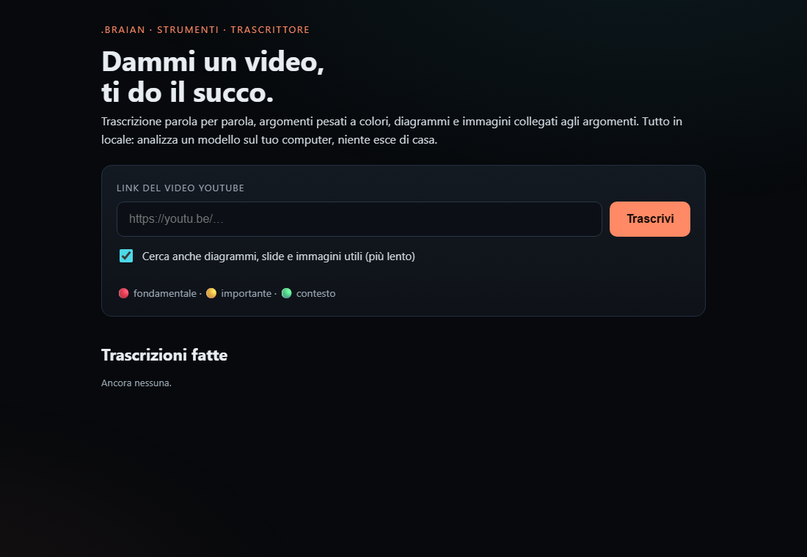
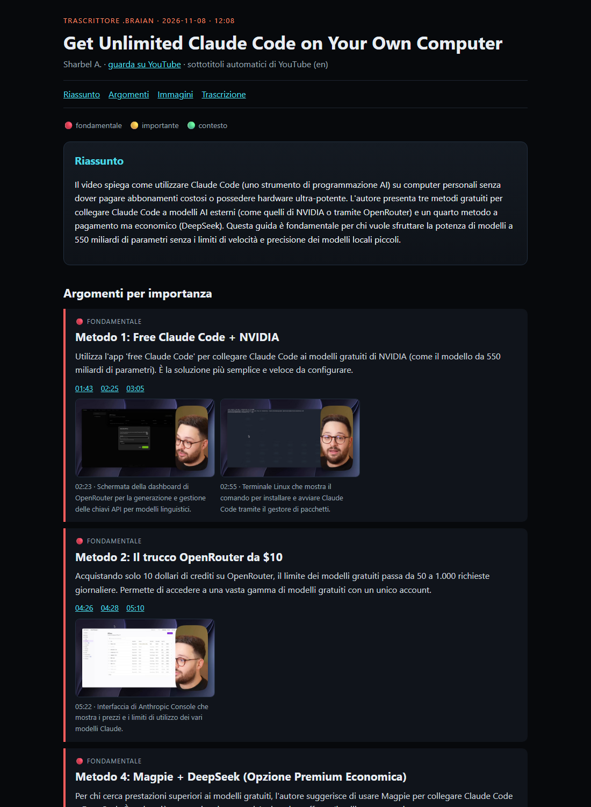

# Trascrittore .brAIan

**Dammi un video, ti do il succo.**

[🇬🇧 README in English](README.md)

Incolli un link di YouTube e ti torna indietro:

- la **trascrizione parola per parola**, con i minuti cliccabili;
- gli **argomenti principali in ordine di importanza**: 🔴 fondamentale · 🟡 importante · 🟢 contesto;
- i **fotogrammi utili**: diagrammi, slide, tabelle, codice, schermate di programmi. Li sceglie un modello locale che guarda le immagini, e li **collega all'argomento** a cui appartengono. Le persone che parlano in camera e le schermate doppie vengono scartate;
- un **file Markdown per le tue AI** e una **pagina HTML a colori** da leggere tu.

Tutto gira **sul tuo computer**. Sottotitoli e video arrivano da YouTube. L'analisi la fa un modello locale con [Ollama](https://ollama.com). Se il video non ha sottotitoli lo trascrive [faster-whisper](https://github.com/SYSTRAN/faster-whisper). Verso servizi di AI esterni non esce niente.




## Cosa serve

- Python 3.10 o più recente.
- [Ollama](https://ollama.com) acceso, con un modello che veda le immagini. Quello predefinito è Gemma 4 12B:
  ```bash
  ollama pull gemma4:12b
  ```
- Facoltativa, una scheda NVIDIA per Whisper. Su Windows e Linux aggiungi `nvidia-cublas-cu12` e `nvidia-cudnn-cu12` nel venv.

## Avvio

**Windows:** doppio clic su `avvia.cmd`. La prima volta prepara tutto da solo.

**macOS / Linux:**
```bash
chmod +x avvia.sh
./avvia.sh
```

Si apre la pagina <http://127.0.0.1:8781>, raggiungibile solo dal tuo computer. Incolli il link, scegli se vuoi anche le immagini e premi **Trascrivi**.

**Da riga di comando:**
```bash
python motore.py "https://youtu.be/..."
python motore.py "https://youtu.be/..." --senza-immagini
```

## Impostazioni

| Variabile | Predefinito | A cosa serve |
|---|---|---|
| `TRASCRITTORE_USCITA` | `~/Trascrizioni` | dove salvare i risultati |
| `TRASCRITTORE_MODELLO` | `gemma4:12b` | modello Ollama (deve vedere le immagini) |
| `OLLAMA_HOST` | `http://127.0.0.1:11434` | dove gira Ollama; può essere un altro computer della tua rete |
| `TRASCRITTORE_PORTA` | `8781` | porta della pagina |

Quanto è severa la scelta delle immagini lo decidi in cima alla sezione fotogrammi di `motore.py`, con `VALORE_MINIMO`, `MAX_IMMAGINI` e `SIMILE`.

## Come funziona

1. **Informazioni** sul video con `yt-dlp`: titolo, canale, durata, capitoli.
2. **Trascrizione**: prima i sottotitoli dell'autore, poi quelli automatici di YouTube, e se mancano Whisper. Il testo viene diviso in blocchi da circa 40 secondi.
3. **Argomenti**: il modello legge i blocchi numerati e restituisce il riassunto, da 4 a 10 argomenti pesati e i blocchi più densi, che vengono evidenziati.
4. **Fotogrammi**: il video viene scaricato in 720p e si prendono i cambi di scena. Il modello dà un voto da 0 a 5 a ogni immagine e passano solo il 4 e il 5 senza persone in primo piano. I doppioni si scartano, e se ne tengono al massimo 12, ognuno collegato al suo argomento.
5. **Risultato**: `trascrizione.md`, `trascrizione.html`, `dati.json` e `fotogrammi/`, in una cartella `<data>_<titolo>`.

## Limiti, detti chiari

- Le risposte sono in italiano.
- I sottotitoli automatici di YouTube sono quello che sono.
- Un modello da 12B a volte sbaglia il nome di quello che vede. Il testo della trascrizione però non viene mai riscritto.
- Rispetta chi fa i video: serve per appunti di studio personali, non per ripubblicare il lavoro degli altri.

## Progetti simili

Altri ci sono arrivati prima su pezzi di questa idea: [summarize](https://github.com/steipete/summarize), [claude-real-video](https://github.com/HUANGCHIHHUNGLeo/claude-real-video), [video-fetcher-to-markdown](https://github.com/JimmySadek/video-fetcher-to-markdown), [reko](https://github.com/riccardoruspoli/reko), [lecture2notes](https://github.com/HHousen/lecture2notes). Questo mette insieme gli argomenti pesati, la trascrizione evidenziata e le immagini scelte da un modello e collegate agli argomenti, tutto in locale.

## Parte di .brAIan

È il primo pezzo pubblico di **.brAIan**, un'AI personale e locale che sto costruendo passo dopo passo, a passettini da formica. Idee, segnalazioni e contributi sono benvenuti.

## Licenza

[MIT](LICENSE)
