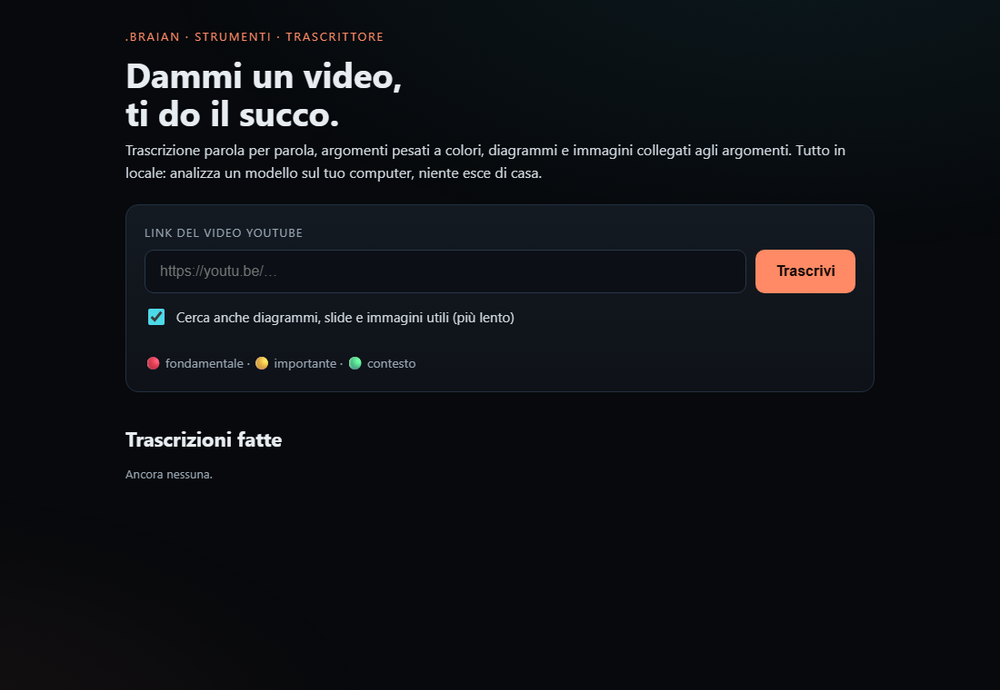
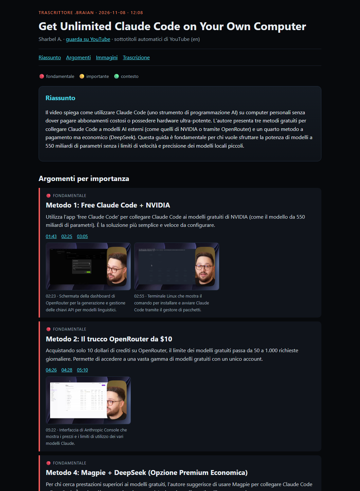

# Trascrittore .brAIan

**Give it a video, get the gist.** *(Dammi un video, ti do il succo.)*

[🇮🇹 Leggimi in italiano](LEGGIMI.md)

Paste a YouTube link. You get back:

- the **word-for-word transcript**, with clickable timestamps;
- the **main topics ranked by importance**: 🔴 core · 🟡 important · 🟢 context;
- the **useful frames** (diagrams, slides, tables, code, software screens), picked by a local vision model and **linked to the topic they belong to**. Talking heads and near-duplicate screens are thrown away;
- a **Markdown file made for your AIs** (front matter, summary, topics, images, full transcript), plus a **coloured HTML page** made for you to read.

Everything runs **on your own computer**. Captions and the video come from YouTube. The analysis is done by a local model through [Ollama](https://ollama.com). If a video has no captions, [faster-whisper](https://github.com/SYSTRAN/faster-whisper) transcribes it. Nothing is sent to an external AI service.




## Why

I watch a lot of videos to keep up with AI. I wanted them in a form my own AI assistants can read, and that I can skim in two minutes: what matters, where it is in the video, and the diagrams I would otherwise have to pause and screenshot.

## How it works

1. **Info**: title, channel, duration and chapters, read with `yt-dlp`.
2. **Transcript**: the author's captions first, then YouTube's auto captions, then Whisper as a fallback (GPU if available, CPU otherwise). The text is grouped into ~40-second blocks, and chapter boundaries are respected.
3. **Topics**: the local model reads the numbered blocks and returns a summary, 4 to 10 topics ranked by importance, and the densest blocks. Those blocks are highlighted in the transcript. Long videos are read in windows and merged.
4. **Frames** (optional): the video is downloaded at 720p or less, keyframes are decoded, and a frame is kept as a candidate when the scene changes. The model looks at each candidate and gives it a score from 0 to 5, also saying whether a person fills the frame. Only frames scoring 4 or 5 with no big face survive. Near-duplicates are removed, and at most 12 frames are kept. Each one is attached to the topic of the moment it comes from.
5. **Output**: `trascrizione.md`, `trascrizione.html`, `dati.json` and `fotogrammi/*.jpg`, in a folder named `<date>_<title>`.

## Requirements

- Python 3.10+
- [Ollama](https://ollama.com) running, with a model that can see images. The default is Gemma 4 12B:
  ```bash
  ollama pull gemma4:12b
  ```
  Any other vision model works too: set `TRASCRITTORE_MODELLO`.
- Optional: an NVIDIA GPU for Whisper. On Windows/Linux also install `nvidia-cublas-cu12` and `nvidia-cudnn-cu12` in the venv.

## Start

**Windows:** double-click `avvia.cmd`. The first run sets up the environment.

**macOS / Linux:**
```bash
chmod +x avvia.sh
./avvia.sh
```

The page opens at <http://127.0.0.1:8781>. It is only reachable from your own computer.

**From the command line:**
```bash
python motore.py "https://youtu.be/..."
python motore.py "https://youtu.be/..." --senza-immagini
```

## Settings

| Variable | Default | What it does |
|---|---|---|
| `TRASCRITTORE_USCITA` | `~/Trascrizioni` | where results are saved |
| `TRASCRITTORE_MODELLO` | `gemma4:12b` | Ollama model (it must handle images) |
| `OLLAMA_HOST` | `http://127.0.0.1:11434` | where Ollama runs; it can be another machine on your network |
| `TRASCRITTORE_PORTA` | `8781` | port of the local page |

How strict the frame picking is can be tuned at the top of the frames section in `motore.py`, with `VALORE_MINIMO`, `MAX_IMMAGINI` and `SIMILE`.

## Limits, honestly

- The prompts and the output are in **Italian** (the code is in Italian too). English prompts are welcome as a contribution.
- YouTube's auto captions are as good as they are.
- A 12B model sometimes names what it sees wrong, for example the wrong website. The transcript itself is never rewritten.
- With images, a 12-minute video takes about 4 minutes on an RTX A4500. Without images it takes under a minute.
- Respect the creators: this is for personal study notes. Don't republish other people's videos or frames.

## Similar projects (go look at them)

Others had parts of this idea first, and they are worth knowing:
- [steipete/summarize](https://github.com/steipete/summarize): summaries of links, videos and podcasts, with scene-based slides.
- [claude-real-video](https://github.com/HUANGCHIHHUNGLeo/claude-real-video): scene-aware frames plus transcript, so an LLM can "watch" a video.
- [video-fetcher-to-markdown](https://github.com/JimmySadek/video-fetcher-to-markdown): videos into Obsidian-ready Markdown notes.
- [reko](https://github.com/riccardoruspoli/reko): local-first Markdown summaries with Ollama.
- [lecture2notes](https://github.com/HHousen/lecture2notes): slide classification and notes from lectures.

What this one adds is the combination: topics ranked by importance, a highlighted word-for-word transcript, and frames chosen by a vision model and linked to the topics, all local.

## Part of .brAIan

This is the first public piece of **.brAIan**, a personal, local-first AI I'm building step by step. Small steps, like an ant. Issues, ideas and pull requests are welcome.

## License

[MIT](LICENSE)
